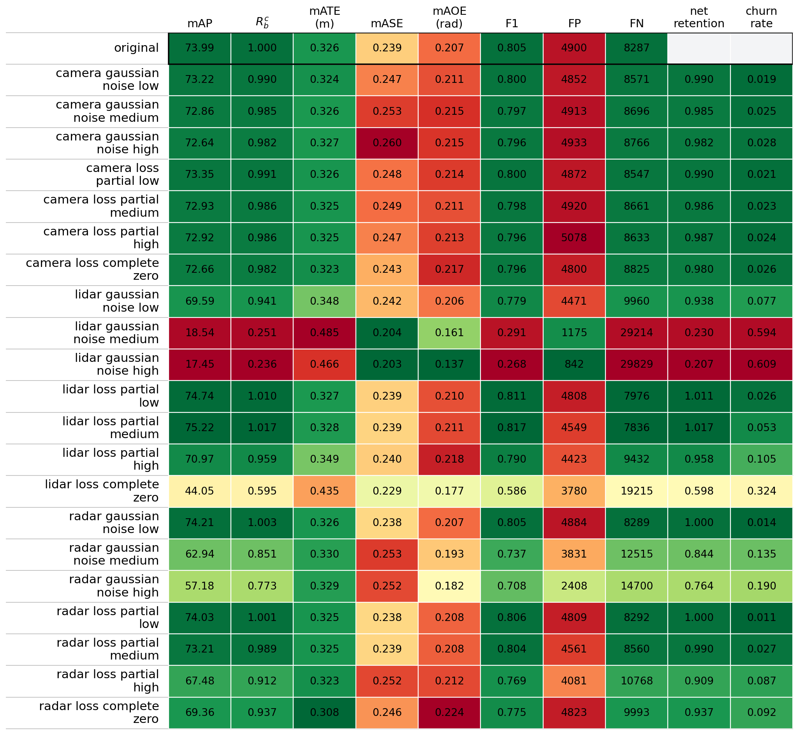

# Robustness of Availability-Aware Sensor Fusion Under Synthetic Sensor Corruption

*An In-Depth Evaluation of ASF on K-Radar Across Weather, Distance, and Sensor-Failure Conditions*

Benchmarks used to report multi-sensor fusion performance for autonomous driving are dominated by clear-weather, daytime, uncrowded conditions, which leaves a gap between reported accuracy and behaviour under real-world sensor degradation. This project examines that gap for Availability-aware Sensor Fusion (ASF), a camera, LiDAR and 4D-radar 3D object detector from the creators of the K-Radar dataset, which is presented as robust to sensor degradation and failure. It does not propose a new fusion architecture. The officially released ASF checkpoint is run unmodified on the 58-sequence K-Radar test split under a synthetic corruption taxonomy: four effects (Gaussian noise, partial loss, complete loss, frame deletion), each applied independently to camera, LiDAR and radar, at three severities (complete loss has a single level). The corrupted detections are compared with the clean run. Inference ran on the Chalmers Alvis cluster (NVIDIA A40 GPUs). This repository holds the corruption definitions, the metric and analysis code, a per-object visibility pipeline, and the small result tables and figures. Large data is shared separately (see [Data and reproducibility](#data-and-reproducibility)).


*Evaluation workflow. The figure's box says "36 conditions": the nominal grid of 3 modalities x 4 effects x 3 severities. Complete loss has a single level, so 30 corrupted conditions exist (clean run not counted): 21 evaluable plus 9 frame-deletion. Checked against `configs/noise/single/` (30 files) and `row_table_iou03.parquet` (30 corrupted conditions plus `original`).*

## Key results

The results are as follows. Scope: one model checkpoint, one dataset (K-Radar test split: 58 sequences, 13,727 baseline frames, 35,456 sedan and bus/truck ground-truth objects), 30 corrupted conditions (clean run not counted): 21 evaluable, including the 3 `loss_complete_zero` conditions, and 9 frame-deletion conditions that could not be evaluated.



*Pooled metrics per condition ([`results/figures/metrics_table.png`](results/figures/metrics_table.png)). R_b^c is corrupted mAP divided by clean mAP.*

1. **LiDAR Gaussian noise causes the largest drop, and it is a step, not a slope.** Pooled mAP goes from 73.99 (clean) to 69.59 at low severity, then 18.54 (medium) and 17.45 (high); R_b^c is 0.251 and 0.236. False negatives rise from 8,287 to 29,214 / 29,829 while false positives fall from 4,900 to 1,175 / 842, so the drop comes from missed detections rather than spurious ones.
2. **Complete LiDAR loss (zero-filled) is less damaging than medium or high LiDAR noise.** mAP 44.05, R_b^c 0.595. A noisy-but-present LiDAR hurts more than an absent one in this sweep. Note that the sweep never tells ASF's availability mechanism that a sensor is absent; this result describes zero-filled input, not declared exclusion.
3. **Camera corruption barely moves the output.** Every camera condition stays between mAP 72.64 and 73.35 (R_b^c >= 0.982). Composite Robustness Index (CRI, 1 = AP stays high and stable across severities): camera loss-partial 0.936 / 0.929 (sedan / bus-truck), camera Gaussian noise 0.915 / 0.842, versus LiDAR Gaussian noise 0.106 / 0.153.
4. **Radar sits in between.** Radar Gaussian noise gives mAP 62.94 (medium) and 57.18 (high); radar loss-partial at low and medium severity stays close to baseline. CRI for radar Gaussian noise is 0.272 for both classes.
5. **LiDAR Gaussian noise is the worst single cell in 9 of the 10 axis-class pairs** (weather, environment, time of day, distance, point density; sedan and bus/truck), always at medium or high severity. The exception is bus/truck in rain, where complete LiDAR loss gives R_b^c = 0.000 (N = 120). Sedan examples: 0.114 in the densest point-density bin, 0.154 at 0 to 20 m. Cells with N > 30 only.
6. **Frame deletion crashed the pipeline for all three sensors.** ASF's sparse-convolution backbone raises a `RuntimeError` on the empty input (radar, LiDAR) and the camera case also crashes, so none of the nine frame-deletion conditions has a metric.


*Retention by modality (same data as the table). Marker size scales with the sample count N.*

The pooled metrics figure above is the table behind items 1 to 4. The CRI values (item 3), the per-axis worst cells (item 5) and the frame-deletion crash (item 6) are documented in the written report (`Misc/docs_external/Latex_Report/`, not tracked).

**Limitations.**
- One checkpoint and one dataset; nothing here says how other fusion models behave.
- The re-run baseline sits 3.2 to 5.6% below the numbers in the ASF paper (sedan BEV AP 77.86 vs 82.5; bus/truck BEV AP 67.93 vs 70.2; same checkpoint, IoU 0.3, official evaluation code). The gap is not explained here.
- Several weather and environment categories rest on 2 to 7 sequences or few objects; they are reported but not treated as general findings.
- mATE, mASE and mAOE are computed over true positives only, so at the collapsed conditions they describe a smaller, easier surviving population. Their apparent improvement there is a survivorship artefact.
- The mFR metric is excluded from the metrics stack: no frame-level flip/consistency computation exists in this pipeline (`scripts/analysis/master_metrics_table.py` docstring).
- mAP throughout is the **aggregated** mAP: the num_gt-weighted mean of the cell-level restricted-range AP over both classes and all stratum cells in `crossproduct_v2/summary_full_density.parquet` (clean = 73.99). It is not the mean of the two per-class APs (72.89). `results/tables/master_metrics_table.md` was regenerated on that definition and reproduces every mAP and R_b^c in the pooled metrics figure to the printed precision. mASE differs slightly between the two (clean 0.236 in the table, 0.239 in the figure; LiDAR noise medium 0.201 vs 0.204): the repo has two mASE implementations (an earlier audit found `crossproduct.py` uses a different formula), and which one the figure used was not traced. RCE is still computed per class. Other chart scripts (`heatmaps.py`, `bar_charts.py`, ...) still use the per-class mean mAP. See [`results/RESULTS.md`](results/RESULTS.md).

## Repository map

```
README.md          this file
CLAUDE.md          instructions for the Claude Code agent working in this repo
pyproject.toml     one uv project for everything (Python >= 3.12)
src/               first-party packages (import with `uv run`; paths come from src/amscup_paths.py)
  kradar_visibility/   per-object radar / LiDAR / camera visibility scores -> Parquet;
  robustness/          prediction ingest, AP, retention, CRI, churn (vendored from the K-Radar fork)
  effects/             the corruption (noise) definitions and their visualisation
  amscup_paths.py      single source of truth for every filesystem path
configs/           ASF configs (final run + per-sequence), noise-effect configs, camera calibration, train/test split
scripts/           runnable entry points, by purpose: visibility/, analysis/, data_transfer/, cluster_historical/
tests/             smoke tests (SMK-*) and verification tests (VER-*)
results/           tracked, curated tables and figures (index: results/RESULTS.md)
data/              NOT tracked: datasets and generated tables (catalogue: data/DATA.md)
docs/              methodology, reports, presentation material, figures (index: docs/README.md)
Misc/              everything moved out of the main tree during the restructure (nothing deleted; not tracked)
```

## How to navigate

| I want to... | Go to |
|---|---|
| Understand the method | `docs/methodology/` (start with `ASF_pipeline_cheatsheet.md`, `04_visibility_methodology.md`) |
| See the results | this README, then [`results/RESULTS.md`](results/RESULTS.md) |
| See where every table and figure comes from | [`data/DATA.md`](data/DATA.md) and [`scripts/README.md`](scripts/README.md) |
| Reproduce a table or figure | [Quickstart](#quickstart), then `scripts/analysis/` |
| Run the visibility pipeline | `scripts/visibility/run_pipeline.py` (needs the K-Radar dataset) |
| See how corruptions are defined | `src/effects/noise_injection.py`, `configs/noise/` |
| See how ASF was configured | [`configs/README.md`](configs/README.md) |
| Read the audits and verification reports | `docs/reports/`, `docs/methodology/verification_report.md` |

## Quickstart

```bash
git clone <repo-url> && cd <repo-dir>      # no submodules; nothing to --recurse
uv sync                                    # installs the single project (Python >= 3.12)
# download the data bundle (link below) and unpack it so that data/results/ exists
uv run python -c "import sys; sys.path.insert(0, 'scripts/analysis'); \
  import master_metrics_table as m; print(m.build_all_tables(out_dir=__import__('pathlib').Path('/tmp/mmt')))"
uv run pytest tests/test_smoke.py          # needs the K-Radar dataset (see below)
```


## Data and reproducibility

- **Tracked:** code, configs, docs, and the small tables and figures in `results/`.
- **Not tracked (`data/`):** generated tables (`row_table_iou03.parquet`, `full_denormalized_table_*.parquet`, `crossproduct*/`), figures and visibility Parquets. About 13 GB in total. Shared through a drive link: **TODO: add link**. Details in [`data/DATA.md`](data/DATA.md).
- **Not included at all:** the K-Radar dataset itself. Obtain it from its authors and set `KRADAR_DATASET_ROOT` (default `data/KRadar`).
- **What can be regenerated:** every downstream table and figure, from the Parquet row tables, with the scripts in `scripts/analysis/`.
- **What cannot be regenerated:** the ASF predictions. They were produced on the Chalmers Alvis cluster (NVIDIA A40 GPUs, SLURM array jobs), and that compute is permanently unavailable. The files in `scripts/cluster_historical/` and the `*_alvis.yml` configs document how the sweep ran; they are for reference, not a current workflow. The local data is the ceiling for any further analysis.


## References

Repositories this work builds on or uses:

- **K-Radar** (KAIST AVELab), dataset and benchmark code: <https://github.com/kaist-avelab/K-Radar>
- **K-Radar fork** used for the evaluation code, corruption definitions and ASF configs vendored into `src/` and `configs/`: <https://github.com/AdyuthHisham/K-Radar>
- **AMSCUP_PLUS**, cluster job and data-extraction tooling (historical): <https://github.com/AdyuthHisham/AMSCUP_PLUS>
- **AMSCUP_LATEX**, written report source: <https://github.com/AdyuthHisham/AMSCUP_LATEX>
- **AI-MSF-Benchmark**, multi-sensor-fusion corruption benchmark (kept in `Misc/`, not used by the code here): <https://github.com/MSFTest/AI-MSF-Benchmark>
- **OpenPCDet** (MMLAB): <https://github.com/open-mmlab/OpenPCDet>
- **Rotated_IoU** (lilanxiao): <https://github.com/lilanxiao/Rotated_IoU>
- **kitti-object-eval-python** (traveller59): <https://github.com/traveller59/kitti-object-eval-python>
- **ASF** (Availability-aware Sensor Fusion), official release by the K-Radar authors: repository link to be added.

OpenPCDet, Rotated_IoU and kitti-object-eval-python are the sources K-Radar acknowledges for its evaluation code, which `src/robustness/` reuses.

## License

TODO. No top-level license file exists in this repo.
