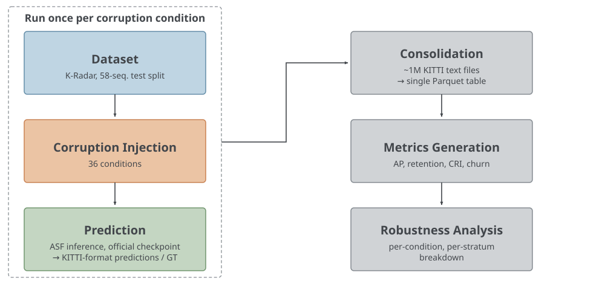
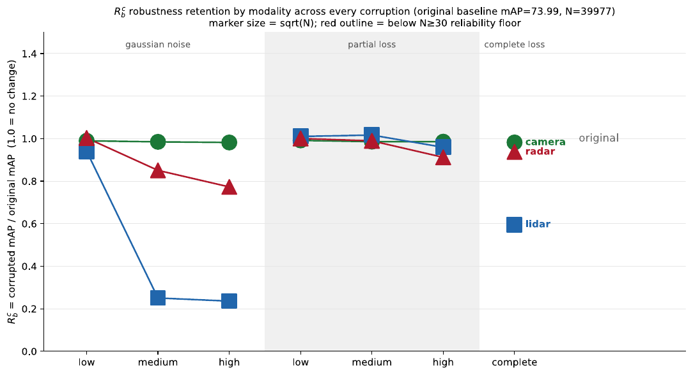

# AMSCUP: robustness of camera / LiDAR / 4D-radar fusion under sensor corruption

AMSCUP is the code, configuration and analysis behind a Chalmers MSc thesis that asks how a multi-sensor 3D detector behaves when its sensors are noisy, partly lost or absent. The model under test is Availability-aware Sensor Fusion (ASF, camera + LiDAR + 4D radar). It is run **unmodified, from its officially released checkpoint**, on the 58-sequence K-Radar test split. Twelve synthetic corruption effects (Gaussian noise, partial loss, complete loss, frame deletion; applied to each sensor separately at three severities) are injected, and the detections are compared with the clean run. The repo holds the corruption definitions, the metric and analysis code, a per-object visibility pipeline, and the small result tables and figures. Large data is shared separately (see [Data and reproducibility](#data-and-reproducibility)).



*Workflow (thesis Figure "Overview of the evaluation pipeline", Methods chapter). The "36 conditions" are 12 effects x 3 severities.*

## Key results

All numbers below are from the thesis (Results chapter). The figure files are tracked copies; the table or figure each number comes from is named. Scope: one model checkpoint, one dataset (K-Radar test split: 58 sequences, 13,727 baseline frames, 35,456 sedan and bus/truck ground-truth objects), 22 evaluable conditions plus the frame-deletion conditions, which could not be evaluated.


*Pooled metrics per condition (thesis Fig. "metrics_table"; same file as [`results/figures/metrics_table.png`](results/figures/metrics_table.png)). R_b^c is corrupted mAP divided by clean mAP.*

1. **LiDAR Gaussian noise causes the largest drop, and it is a step, not a slope.** Pooled mAP goes from 73.99 (clean) to 69.59 at low severity, then 18.54 (medium) and 17.45 (high); R_b^c is 0.251 and 0.236. False negatives rise from 8,287 to 29,214 / 29,829 while false positives fall from 4,900 to 1,175 / 842, so the drop comes from missed detections rather than spurious ones. Source: pooled metrics figure above.
2. **Complete LiDAR loss (zero-filled) is less damaging than medium or high LiDAR noise.** mAP 44.05, R_b^c 0.595. A noisy-but-present LiDAR hurts more than an absent one in this sweep. Source: same figure. Note that the sweep never tells ASF's availability mechanism that a sensor is absent (thesis, discussion of cause); this result describes zero-filled input, not declared exclusion.
3. **Camera corruption barely moves the output.** Every camera condition stays between mAP 72.64 and 73.35 (R_b^c >= 0.982). Source: same figure. Composite Robustness Index (CRI, 1 = AP stays high and stable across severities): camera loss-partial 0.936 / 0.929 (sedan / bus-truck), camera Gaussian noise 0.915 / 0.842, versus LiDAR Gaussian noise 0.106 / 0.153. Source: thesis CRI table.
4. **Radar sits in between.** Radar Gaussian noise gives mAP 62.94 (medium) and 57.18 (high); radar loss-partial at low and medium severity stays close to baseline. CRI for radar Gaussian noise is 0.272 for both classes. Source: pooled metrics figure and CRI table.
5. **LiDAR Gaussian noise is the worst single cell in 9 of the 10 axis-class pairs** (weather, environment, time of day, distance, point density; sedan and bus/truck), always at medium or high severity. The exception is bus/truck in rain, where complete LiDAR loss gives R_b^c = 0.000 (N = 120). Sedan examples: 0.114 in the densest point-density bin, 0.154 at 0 to 20 m. Source: thesis table "single worst cell per diversity axis and class" (cells with N > 30).
6. **Frame deletion crashed the pipeline for all three sensors.** ASF's sparse-convolution backbone raises a `RuntimeError` on the empty input (radar, LiDAR) and the camera case also crashes, so none of the nine frame-deletion conditions has a metric. Source: thesis, frame-deletion section.



*Retention by modality (same data as the table; thesis draft figure). Marker size scales with the sample count N.*

**Limitations.**
- One checkpoint and one dataset; nothing here says how other fusion models behave.
- The re-run baseline sits 3.2 to 5.6% below the numbers in the ASF paper (sedan BEV AP 77.86 vs 82.5; bus/truck BEV AP 67.93 vs 70.2; same checkpoint, IoU 0.3, official evaluation code). The thesis reports the gap but does not explain it.
- Several weather and environment categories rest on 2 to 7 sequences or few objects; the thesis flags them rather than treating them as general findings.
- mATE, mASE and mAOE are computed over true positives only, so at the collapsed conditions they describe a smaller, easier surviving population. Their apparent improvement there is a survivorship artefact.
- The mFR metric is excluded from the metrics stack (decision of 2026-09-01); it is not implemented here.
- `master_metrics_table.md` in `results/tables/` is regenerated from the local row table and gives a clean mAP of 72.89 (LiDAR noise medium 23.71, high 21.56), not the thesis's 73.99 / 18.54 / 17.45. Both come from this repo's data; the pooling that explains the difference was not traced. Treat the thesis figure as the reported result. See [`results/RESULTS.md`](results/RESULTS.md).

## Repository map

```
README.md          this file
CLAUDE.md          instructions for the Claude Code agent working in this repo
pyproject.toml     one uv project for everything (Python >= 3.12)
src/               first-party packages (import with `uv run`; paths come from src/amscup_paths.py)
  kradar_visibility/   per-object radar / LiDAR / camera visibility scores -> Parquet;
  robustness/          prediction ingest, AP, retention, CRI, churn (vendored from the K-Radar fork)
  effects/             the corruption (noise) definitions and their visualisation
  amscup_paths.py      single source of truth for every filesystem path
configs/           ASF configs (final run + per-sequence), noise-effect configs, camera calibration, train/test split
scripts/           runnable entry points, by purpose: visibility/, analysis/, data_transfer/, cluster_historical/
tests/             smoke tests (SMK-*) and verification tests (VER-*)
results/           tracked, curated tables and figures (index: results/RESULTS.md)
data/              NOT tracked: datasets and generated tables (catalogue: data/DATA.md)
docs/              methodology, reports, presentation material, figures (index: docs/README.md)
Misc/              everything moved out of the main tree during the restructure (nothing deleted; not tracked)
```

## How to navigate

| I want to... | Go to |
|---|---|
| Understand the method | `docs/methodology/` (start with `ASF_pipeline_cheatsheet.md`, `04_visibility_methodology.md`) |
| See the results | this README, then [`results/RESULTS.md`](results/RESULTS.md) |
| See where every table and figure comes from | [`data/DATA.md`](data/DATA.md) and [`scripts/README.md`](scripts/README.md) |
| Reproduce a table or figure | [Quickstart](#quickstart), then `scripts/analysis/` |
| Run the visibility pipeline | `scripts/visibility/run_pipeline.py` (needs the K-Radar dataset) |
| See how corruptions are defined | `src/effects/noise_injection.py`, `configs/noise/` |
| See how ASF was configured | `configs/asf/` (`ASF_v2_0_final.yml` matches the released `ASF_v2_0_final_10.pt` checkpoint; `ASF_v2_0_seq<N>_alvis.yml` are the per-sequence cluster configs; I did not verify which file each run used) |
| Read the audits and verification reports | `docs/reports/`, `docs/methodology/verification_report.md` |
| Contribute | `CLAUDE.md` (conventions), `tests/`, `scripts/README.md` |

## Quickstart

```bash
git clone <repo-url> && cd AMSCUP          # no submodules; nothing to --recurse
uv sync                                    # installs the single project (Python >= 3.12)
# download the data bundle (link below) and unpack it so that data/results/ exists
uv run python -c "import sys; sys.path.insert(0, 'scripts/analysis'); \
  import master_metrics_table as m; print(m.build_all_tables(out_dir=__import__('pathlib').Path('/tmp/mmt')))"
uv run pytest tests/test_smoke.py          # needs the K-Radar dataset (see below)
```

The regeneration command was run on the full local bundle (about 18 s) and reproduced `results/tables/master_metrics_table.md` exactly. `scripts/analysis/master_metrics_table.py` also runs standalone with `uv run python scripts/analysis/master_metrics_table.py`, but that overwrites the copy in `data/results/robustness_reports/`, so the snippet above writes elsewhere.

**Smoke tests need the K-Radar dataset, which is not in this repo or the bundle.** Without it `tests/test_smoke.py` fails at the first test (file not found under `data/KRadar/`). Point `KRADAR_DATASET_ROOT` at your copy of the dataset to run them. Current state of `tests/test_smoke.py` on the restructured tree: 9 passed, 11 failed. Ten of the failures are missing-dataset errors; **SMK-21 (LiDAR range-image float32 bin boundary) is a real failure under the locked `numpy 2.4.6`**. The same code and test pass in the pre-restructure project, which ran `numpy 1.26.4`. The cause is probably numpy 2 scalar-promotion changes; the fix (pin `numpy<2`, or make the binning dtype-explicit) is an open decision.

## Data and reproducibility

- **Tracked:** code, configs, docs, and the small tables and figures in `results/`.
- **Not tracked (`data/`):** generated tables (`row_table_iou03.parquet`, `full_denormalized_table_*.parquet`, `crossproduct*/`), figures and visibility Parquets. About 13 GB in total. Shared through a drive link: **TODO: add link**. Details in [`data/DATA.md`](data/DATA.md).
- **Not included at all:** the K-Radar dataset itself. Obtain it from its authors and set `KRADAR_DATASET_ROOT` (default `data/KRadar`).
- **What can be regenerated:** every downstream table and figure, from the Parquet row tables, with the scripts in `scripts/analysis/`.
- **What cannot be regenerated:** the ASF predictions. They were produced on the Chalmers Alvis cluster (NVIDIA A40 GPUs, SLURM array jobs), and that compute is permanently unavailable. The files in `scripts/cluster_historical/` and the `*_alvis.yml` configs document how the sweep ran; they are for reference, not a current workflow. The local data is the ceiling for any further analysis.
- Known, expected gap: `camera_frame_deletion` rows are missing from `row_table_iou03.parquet`, because that sweep crashed (result 6 above).

## Third-party code (no submodules)

This repo used to carry K-Radar, AMSCUP_PLUS and the LaTeX report as submodules. They are gone. The pieces the results depend on were copied into `src/` and `configs/`: the AP/robustness scripts (`src/robustness/`, from the K-Radar fork), the corruption definitions (`src/effects/`), and the ASF configs (`configs/asf/`). The K-Radar dataset, the ASF model code and the cluster tooling are not included. Upstream: K-Radar (KAIST) and the ASF authors' release; `src/robustness/LICENSE` (MIT) covers the vendored evaluation code.

## Citation, license, contact

- **License:** TODO. No top-level license file exists in this repo.
- **Citation:** TODO. Add the thesis reference once it is published.
- **Contact:** TODO.
